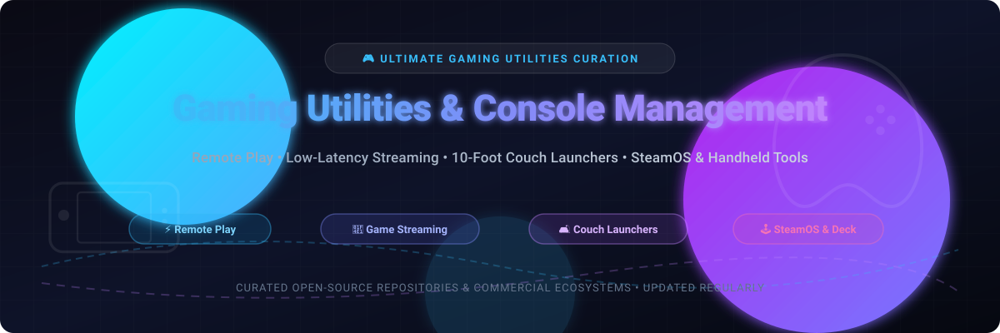

# Awesome-Gaming-Utilities-Console-Management


  





  
  
  
  
  



# 🕹️ Top Gaming Utilities & Console Management

**Curated List of SaaS/Commercial Platforms & Open-Source GitHub Projects**  
*Focused on Unified Game Library Launchers, Console Companion & Remote Play Apps, Self-Hosted Cloud Streaming, Save-Game Sync & Living-Room Console OS*  
**Last updated: November 2026**

This repository tracks notable **SaaS/Commercial platforms** and **open-source projects** for **Gaming Utilities & Console Management**. These tools power unified multi-storefront game launchers (`Playnite`, `Heroic Games Launcher`, `Lutris`), PlayStation and Xbox console remote-play & library management (`playden-ps5`, `PS5LM`, `Chiaki-ng`, `Greenlight`), low-latency self-hosted game streaming (`Sunshine` + `Moonlight`), automated save-game backups (`Ludusavi`), and SteamOS-like living-room console operating systems (`Bazzite`, `ChimeraOS`) for gamers and home-arcade builders.

**Examples** include Xbox App (Microsoft), GeForce NOW (NVIDIA), PlayStation App (Sony Interactive Entertainment), Epic Games Store, Steam (Valve), EA App (Electronic Arts), Ubisoft Connect, GOG Galaxy (CD Projekt), LaunchBox / Big Box (Unbroken Software), and Playnite (Hosted Addon/Metadata Ecosystem) (the category leaders).

**🚀 Open-source emphasis**: This section is heavily expanded with every major active project for PlayStation/Xbox console management & remote play (`leolobato/playden-ps5`, `PS5LM`, `Chiaki-ng`, `Greenlight`), unified multi-storefront game launchers (`Playnite`, `Heroic Games Launcher`, `Lutris`, `Cartridges`, `Bottles`), self-hosted game streaming (`Sunshine`, `Moonlight`), save-game management (`Ludusavi`, `Syncthing`), and console OS distros (`Bazzite`, `ChimeraOS`, `Decky Loader`) — ideal for gamers eliminating launcher bloat and proprietary lock-in.

🤝 Contributions welcome! Open a PR to add/update entries. Keep descriptions factual and link to official sites.

## 📑 Table of Contents
- [📊 Sector Overview & Market Dynamics](#-sector-overview--market-dynamics)
- [☁️ SaaS/Hosted & Commercial Platforms](#️-saashosted--commercial-platforms)
- [💻 Open-Source GitHub Projects](#-open-source-github-projects)
- [🛠️ How to Contribute](#️-how-to-contribute)
- [⚠️ Disclaimer](#️-disclaimer)
- [💖 Support & Thank You](#-support--thank-you)

## 📊 Sector Overview & Market Dynamics

The global Gaming Platforms, Storefront Launchers & Console Companion Software market is valued at approximately **$21B–$26B+ in 2026**, expanding at a ~14%–19% CAGR driven by cross-platform game libraries, handheld PC consoles (Steam Deck, ROG Ally, Legion Go), and remote console play. The commercial storefront layer exhibits **strong winner-take-most consolidation** around Valve (Steam), Sony (PlayStation), Microsoft (Xbox), and Epic Games, resulting in severe launcher fragmentation—which in turn fuels rapid adoption of **unified open-source library managers, console remote-play clients, and bloat-free launchers** (`Playnite`, `Heroic`, `Chiaki-ng`, `Greenlight`, `Ludusavi`).

## ☁️ SaaS/Hosted & Commercial Platforms

*Sorted descending by company valuation / annual revenue scale.*

| Platform | Description | Company Scale (Valuation / Revenue) | Starting Paid Tier | Free Tier / Trial Limit |
| :--- | :--- | :--- | :--- | :--- |
| **[Xbox App (Microsoft)](https://xbox.com)** | Official Windows, mobile, and smart-TV console companion app unifying PC Game Pass, Xbox Cloud Gaming, and local Xbox Series X/S remote play. | **Part of Microsoft Corp.** (~$245B+ annual revenue; ~$3T+ market cap) | **$9.99 / month** (Game Pass Core/Standard) or **$19.99 / month** (Game Pass Ultimate) | **Forever Free Console Companion & Remote Play** (100% free local Xbox console remote play, party chat, and owned-game management) |
| **[GeForce NOW (NVIDIA)](https://nvidia.com)** | Cloud RTX GPU game-streaming platform running owned libraries from Steam, Epic, Xbox, and GOG at up to 4K/120fps across desktop, mobile, and TVs. | **Part of NVIDIA Corp.** (~$130B+ annual revenue; ~$3T+ market cap) | **$9.99 / month** ($49.99/6 mos Performance) or **$19.99 / month** ($99.99/6 mos Ultimate RTX 4080/5080) | **Forever Free Basic Tier** (Ad-supported **1-hour session limit** with standard queue access and basic cloud rig) |
| **[PlayStation App & PS Remote Play (Sony)](https://playstation.com)** | Official mobile/PC companion apps for managing PS5/PS4 storage remotely, purchasing titles, party chat, and streaming console gameplay. | **Part of Sony Group Corp.** (~$88B+ annual revenue; ~$110B+ market cap) | **$0 / Free App** (PS Plus Essential starts at **$9.99 / month** or **$79.99 / year** for online multiplayer/cloud saves) | **Forever Free Companion & Local Remote Play** (100% free remote console downloads, capture gallery sync, and PS Remote Play) |
| **[Epic Games Store & Launcher](https://epicgames.com)** | Digital PC/mobile game storefront, Unreal Engine hub, and cross-platform Epic Online Services (EOS) overlay and cloud-save launcher. | **~$22.5B+ Valuation** (~$6B+ annual revenue; backed by Tencent/Sony/Disney) | **$0 / Free Client** (12% storefront revenue share for developers; 0% on first $1M with Epic First Run) | **Forever Free Account & Weekly Free Games** (100% free launcher, cloud saves, and **1–2 free commercial PC/mobile games every week**) |
| **[Steam (Valve)](https://steampowered.com)** | Dominant PC & SteamOS gaming platform featuring Big Picture 10-foot console UI, Steam Input controller mapper, Family Sharing, and Remote Play. | **~$10B–$15B+ Est. Valuation** (~$10B+ est. annual revenue; privately held) | **$0 / Free Client** (30% standard storefront cut for game publishers, scaling down to 20%) | **100% Free Forever** (Unlimited library management, cloud saves, Steam Input remapping, Big Picture UI, and Remote Play) |
| **[EA App (Electronic Arts)](https://ea.com)** | Official desktop launcher, cloud-save manager, and EA Play subscription client for Electronic Arts PC titles and Xbox Game Pass integrations. | **~$7.5B+ Annual Revenue** (~$38B+ public market cap on NASDAQ) | **$5.99 / month** ($39.99/yr for EA Play) or **$16.99 / month** (EA Play Pro) | **Forever Free Launcher** (100% free account, cloud saves, and friend list management for owned EA titles) |
| **[Ubisoft Connect](https://ubisoft.com)** | Cross-platform desktop launcher, cloud-save synchronization, loyalty rewards, and Ubisoft+ subscription hub across PC and consoles. | **~$2.3B+ Annual Revenue** (~$1.8B–$2.5B public market cap on Euronext) | **$7.99 / month** (Ubisoft+ Classics) or **$17.99 / month** (Ubisoft+ Premium) | **Forever Free Launcher** (100% free cross-progression cloud saves, overlay, and library management for owned games) |
| **[GOG Galaxy (CD Projekt)](https://gog.com)** | DRM-free PC storefront client and multi-platform library aggregator unifying Steam, Epic, Xbox, and PlayStation achievements and playtime. | **Part of CD Projekt Group** (~$250M+ annual revenue; ~$4B+ market cap on WSE) | **$0 / Free Client** (30% standard DRM-free storefront cut for publishers) | **100% Free Forever** (Unlimited DRM-free offline installers, cloud saves, and multi-platform library aggregation with zero DRM) |
| **[LaunchBox / Big Box (Unbroken Software)](https://launchbox-app.com)** | Premier Windows/Android game launcher, box-art scraper, and 10-foot living-room console interface ("Big Box") integrating PC stores and emulators. | **~$5M–$15M Est. Scale** (Profitable independent US gaming software company) | **$30 / year** (1-year updates) or **$75 one-time** Forever Updates license for Big Box mode | **Forever Free LaunchBox Desktop** (100% free desktop game library organizer, multi-storefront launcher, and metadata scraper forever) |
| **[Playnite (Hosted Addon & Metadata Ecosystem)](https://playnite.link)** | Open-source unified PC and console game library manager with hosted plugin/theme repositories and customizable 10-foot full-screen UI. | **Community Open-Source Project** (Maintained by Josef Nemec & contributors) | **$0 / Free Open-Source** (Optional Patreon sponsorship) | **100% Free Forever** (MIT-licensed unified launcher integrating Steam, Epic, GOG, Xbox, PlayStation, EA, Ubisoft, and emulators) |

## 💻 Open-Source GitHub Projects

| Project | License / Hosting Cost | Free Tier / Self-Hosted Limit | Description |
| :--- | :--- | :--- | :--- |
